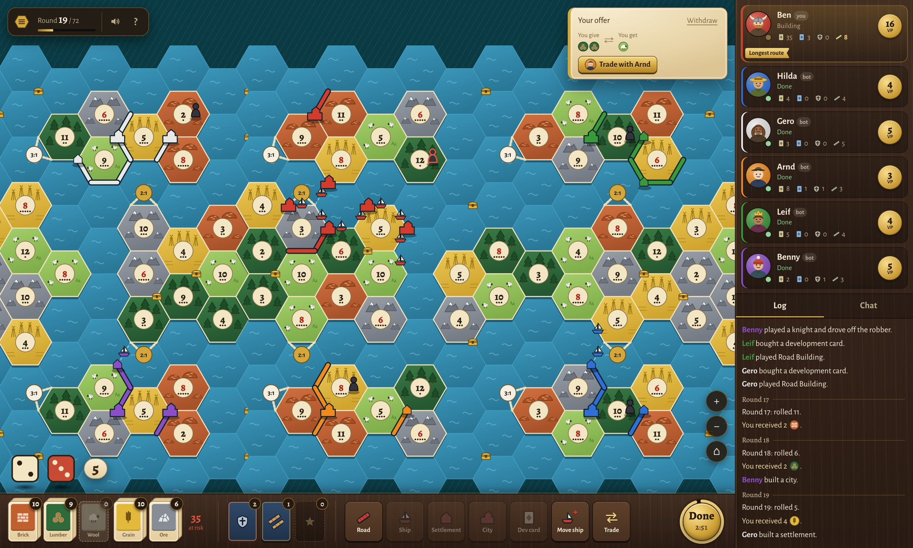

# Multicatan

A fan remake of **Multicatan**, the real-time, six-player Catan variant from the old *Catan Online World* (2007–2016). It never came back after that site shut down, so we rebuilt it to play with friends.



## How it plays

- **Six settlers, one hidden world.** Everyone starts on their own island. The rest of the map is fog until your roads and ships reach it, and the world wraps around like a ring.
- **Everyone plays at once.** No waiting for turns: build and trade, press **Done**, and the dice roll when the last settler is ready (or when the timer runs out).
- **72 rounds.** Most victory points at the end wins.
- **Explore for points.** Settling the central chain of islands, or another settler's home island, is worth bonus points. Treasures are hidden in the fog.
- **Meet your neighbours.** You can only trade with settlers you've discovered, and once you meet them you can see everything they've explored.

Press **?** during a game for the full rules and keyboard shortcuts.

## Playing with friends

One person runs the game and everyone else just opens a link in their browser.

1. Start a game and copy the invite link from the lobby.
2. Send it to your friends. Fill any empty seats with bots.
3. Set sail.

## Running it

You need [Node.js](https://nodejs.org) installed. Then, in this folder:

```bash
npm install
npm run build
npm start
```

The game is now at **http://localhost:3000**. To play with friends outside your home network, put it on a host that runs Docker (there's a `Dockerfile`), or share your computer with a tunnel such as `cloudflared tunnel --url http://localhost:3000`.

---

*A fan project, not affiliated with or endorsed by Catan GmbH. Catan is a trademark of Catan GmbH.*
